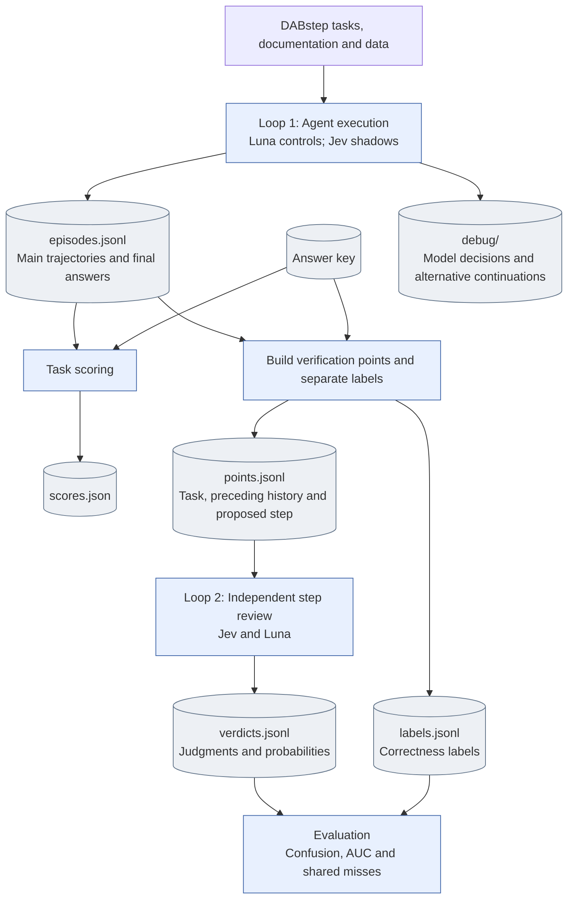
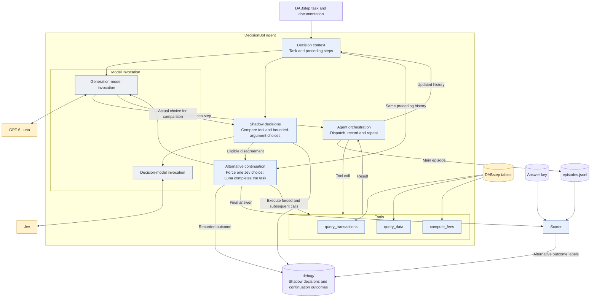
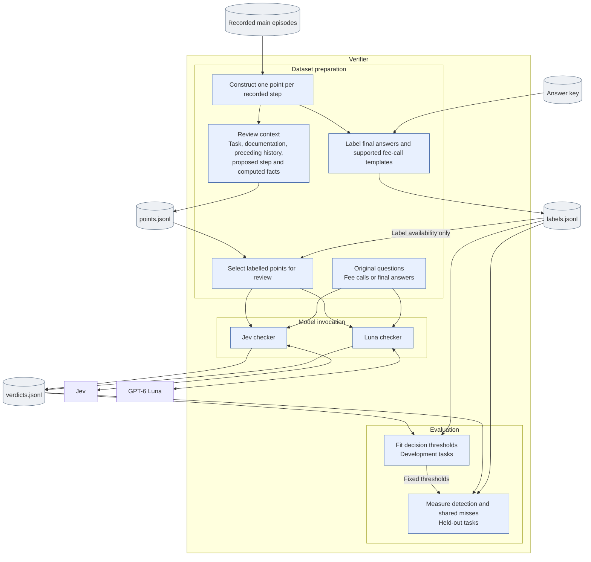

# DecisionBot

## Introduction

DecisionBot is an experimental harness for studying how an AI agent and independent verifiers succeed or fail on the same data-analysis tasks. It consists of two testing loops:

1. **Agent execution:** an autonomous agent uses model inference and tools to solve tasks from the [DABstep benchmark](https://huggingface.co/datasets/adyen/DABstep). In the **shadow configuration used for the published experiment**, Luna decides every step of the main trajectory while Jev proposes tool and bounded-argument choices alongside it. Eligible disagreements produce separate continuations that force one Jev choice before Luna resumes.
2. **Step verification:** recorded main episodes are replayed as review contexts. Jev and Luna independently assess each selected step using the task, documentation, and preceding trajectory. Their judgments are compared with separately constructed correctness labels to measure error detection, false alarms, and shared misses.

### Experiment flow




## License and data attribution

DecisionBot code is licensed under the [Apache License 2.0](LICENSE).

This project uses [DABstep](https://huggingface.co/datasets/adyen/DABstep), created by Adyen and Hugging Face and licensed under [CC BY 4.0](https://creativecommons.org/licenses/by/4.0/).

## Answer-key methodology and access

Astra compiled the initial 450-task reference key from the benchmark data and documentation, recording calculations, citations, and alternative interpretations. The scoring procedure was then corrected and validated against the official right/wrong grades and submitted answers of four DABstep submissions (1,800 answers), including numerical tolerance, formatting, and fee-rule interpretation. Officially accepted answers resolved selected ambiguous tasks; unresolved tasks remain unscored.

The locally reconstructed `answer_key.jsonl` is available from the maintainers on request.

## Usage

### Setup

Run commands from the repository root.

1. Create `.env` with the model credentials:
   ```dotenv
   TYPESAFE_API_KEY=your-jev-key
   OPENAI_API_KEY=your-openai-key
   ```
2. Install the project into its virtual environment:
   ```sh
   uv sync
   ```

### Loop 1: Run the agent

```sh
uv run src/main.py --mode shadow
```

This runs all 450 DABstep tasks and fetches the data on first use.

| Optional argument | Example | Effect |
|---|---|---|
| `--limit` | `--limit 5` | Run only the first N tasks, after any task-ID filtering. |
| `--task-ids` | `--task-ids 18 70 1296` | Run only the specified DABstep tasks. |

Each run creates a timestamped directory under `out/runs/` containing:

| Artifact | Contents |
|---|---|
| `run.json` | Run configuration |
| `episodes.jsonl` | Main episodes, including task, documentation, steps and final answer |
| `debug/` | Per-task model decisions, shadow comparisons and continuation logs |
| `scores.json` | Task-level scores against the answer key |

To score saved episodes without model calls:

```sh
uv run src/main.py --score-only out/runs/YOUR_RUN/episodes.jsonl
```

For VSCode debugging, select the repository's `.venv` interpreter and launch **DecisionBot**. Its current configuration runs shadow mode without a task limit; add `--limit` to its arguments for a smaller run.

### Loop 2: Run the verifiers

Set `AGENT_RUN` to the directory created by Loop 1 and choose a separate verification directory:

```sh
AGENT_RUN=out/runs/YOUR_RUN
R=out/verify/YOUR_VERIFIER_RUN

uv run src/verify.py build --episodes "$AGENT_RUN/episodes.jsonl" --run-dir "$R"

uv run src/verify.py ask --run-dir "$R" --checker decision --model jev-latest
uv run src/verify.py ask --run-dir "$R" --checker openai --model gpt-6-luna --effort medium

uv run src/verify.py report --run-dir "$R"
```

- `build` creates `points.jsonl` and `labels.jsonl` without model calls. It uses the recorded steps and introduces no seeded errors.
- `ask` reviews labelled steps by default and appends results to `verdicts.jsonl`. Repeating the same command resumes from cached successful responses. `--all` also reviews unlabelled steps; that expands beyond the published evaluation.
- `report` prints the built-in evaluation. Its per-question and composite-score selection is distinct from the paper's analysis, which used the action score `1 - P(proceed)` on pooled labelled steps.

## Architecture

### Loop 1: run the eval and generate trajectories



1. **Prepare the task context.** The harness loads each DABstep task, its documentation and the data available to the tools. At each step, it assembles the task and preceding history as the context for the next decision.

2. **Obtain and compare decisions.** Luna chooses the main trajectory's tool calls, arguments and final answer. Jev proposes choices and probabilities over enumerated tool and bounded-argument options. In shadow mode, Luna controls the main trajectory regardless of Jev's confidence; the harness records their agreements and disagreements.

3. **Execute the step and continue.** The harness executes Luna's chosen tool call and adds its result to the history before requesting the next decision. The available tools are `query_transactions` to filter, group and aggregate payments, `query_data` to execute read-only SQL over DABstep tables, and `compute_fees` to match fee rules and calculate merchant fees. This loop continues until the agent submits an answer, reaches its step limit or encounters an error.

4. **Explore alternative decisions.** For an eligible disagreement, the harness also starts a separate continuation from the same preceding history, forces one Jev choice and lets Luna finish. A task can have several such continuations. Each tests the effect of substituting one Jev decision; none replaces the main episode.

5. **Record and score the outcomes.** Main episodes are saved in `episodes.jsonl`; shadow decisions and alternative-continuation outcomes are recorded under `debug/`. The Scorer grades final answers against the answer key, keeping main-agent results separate from alternative outcomes. Loop 2 uses the recorded main episodes to construct its verification points.

### Loop 2: replay trajectories to the verifiers and score them



1. **Prepare the review dataset.** Each recorded step becomes a review point containing the task, documentation, preceding history, proposed step and computed facts. Correctness labels are constructed separately: final answers are graded against the answer key, while supported `compute_fees` templates are checked against the task's required arguments. Labelled points are selected for review by default; unlabelled steps do not enter the default correctness evaluation.

2. **Ask both verifiers.** Jev and Luna independently review each selected point as it appeared before the proposed step took effect. Neither sees later steps, the answer key, correctness labels or task scores. For fee calls, the questions cover period, merchant, exclusions, hypothetical changes and the recommended action. For final answers, they cover the requested quantity, support from tool results, answerability, format and the recommended action. Both checkers return probabilities for the action choices **Proceed, Revise, Recheck and Ask**, alongside their responses to the other questions. These responses are saved in `verdicts.jsonl`.

3. **Calibrate the thresholds.** Odd task IDs form the development set; even IDs form the held-out set, keeping all steps from a task together. The published analysis uses `1 - P(proceed)` as each step's suspicion score. For each verifier, it selects the lowest cutoff that flags no more than **20% of correct development steps**; a step is flagged when its score exceeds that cutoff. The built-in `report` instead selects a question or composite score separately for fee calls and final answers using development AUC, then fits thresholds under the same 20% false-alarm constraint, flagging scores at or above its cutoff.

4. **Evaluate on held-out steps.** The selected scoring rules and thresholds remain fixed. Flags are compared with the held-out correctness labels to measure detected errors, missed errors, false alarms and correct approvals, including errors missed by both verifiers. AUC measures how well suspicion scores separate incorrect from correct steps across thresholds.

