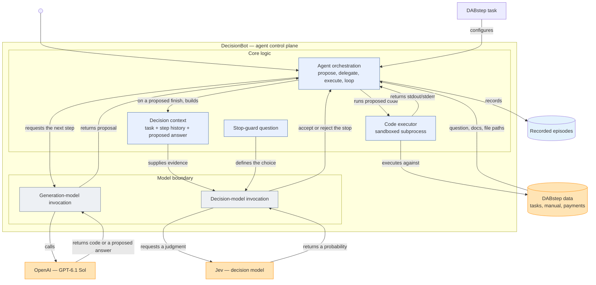
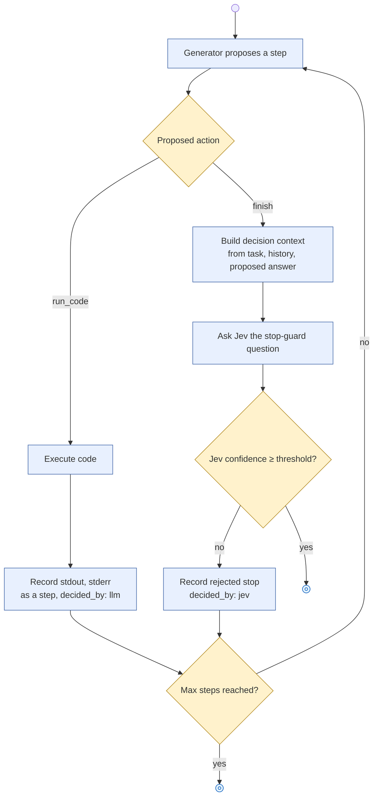
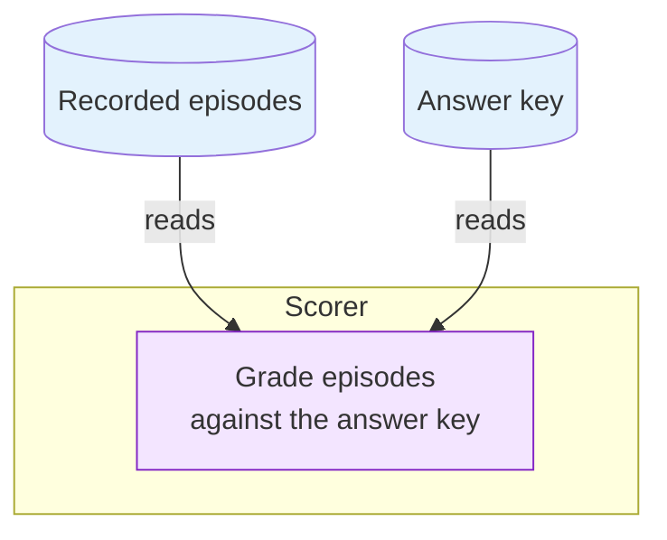

# DecisionBot

A live agent that solves [DABstep](https://huggingface.co/datasets/adyen/DABstep) data-analysis tasks by making tool calls against the real payments dataset, with one decision point — whether a proposed answer is actually ready to submit — delegated to a decision model (Jev) instead of being decided by the agent's own LLM. This reproduces the delegation architecture from "JevAgentHarness: Benchmarking, Deploying and Training Decision Models That Share Control with LLMs" (Zhu et al.), using the DABstep benchmark's tasks, data and documentation as the test environment, and Jev as the decision model.

DecisionBot's runs are scored against an independently computed answer key (`data/answer_key.jsonl`).

## Architecture

Two boundaries matter: the agent's own control plane, where a generation model and a decision model are both invoked but play different roles, and the Scorer, which is deliberately a separate system that never participates in solving a task — it only grades what the agent already recorded.

### Agent



The generation model (Sol) and the decision model (Jev) are invoked through the same kind of boundary but play different roles: Sol does the actual work — it is the only thing that writes code or proposes an answer, since Jev can only answer a typed question with a probability, never generate free text. Jev is asked exactly one question, only when Sol proposes to stop: given the task, the full step history and the proposed answer, is this actually finished and correct? The agent only accepts the stop when Jev's confidence clears the threshold; otherwise the episode continues.



Every step is recorded regardless of outcome, including a rejected stop attempt, so the full episode — what was tried, what Jev overruled, and what finally got submitted — is reconstructible from `EpisodeResult` alone.

### Scoring



The Scorer is a separate system from the agent: it never runs a task, it only reads the episodes the agent already recorded and the answer key, and grades one against the other.

## Usage

Run from the project folder in a terminal:

1. `cd` into this repository.
2. Create `.env` in the repository root (not committed — `.gitignore` excludes it) with:
   ```
   TYPESAFE_API_KEY=your-jev-key
   OPENAI_API_KEY=your-openai-key
   ```
3. `uv sync` — creates `.venv` and installs the project.
4. `uv run src/main.py` — fetches the DABstep data on first run, then runs the agent on one task end to end, printing the resulting `EpisodeResult` and appending it to `out/episodes.jsonl`.

To run and debug it in VSCode instead: run `uv sync` once from the terminal first (VSCode doesn't do this for you), then open the Command Palette and run **Python: Select Interpreter**, choosing the `.venv` that `uv sync` just created. From there, open the Run and Debug panel and launch the **DecisionBot** configuration — it runs `src/main.py` the same way, with breakpoints available anywhere in the call chain.

Scoring against the answer key (`data/answer_key.jsonl`) isn't wired into `main.py` yet — `Scorer.score()` exists and can be called once that file exists, but nothing currently tells you whether a run's answer was actually correct.
