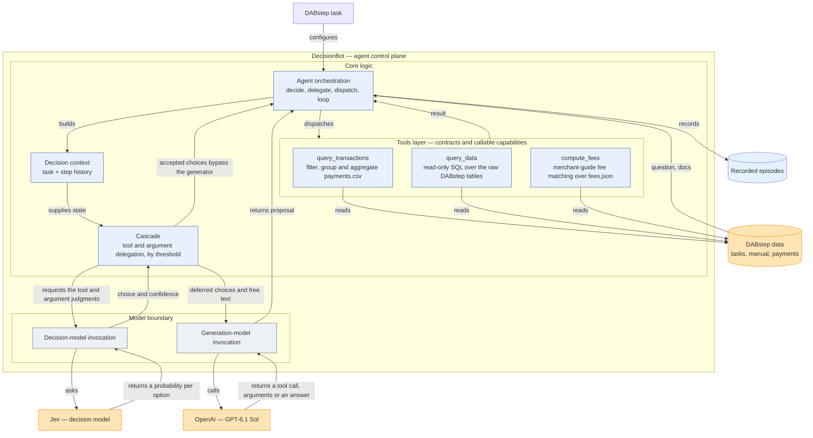
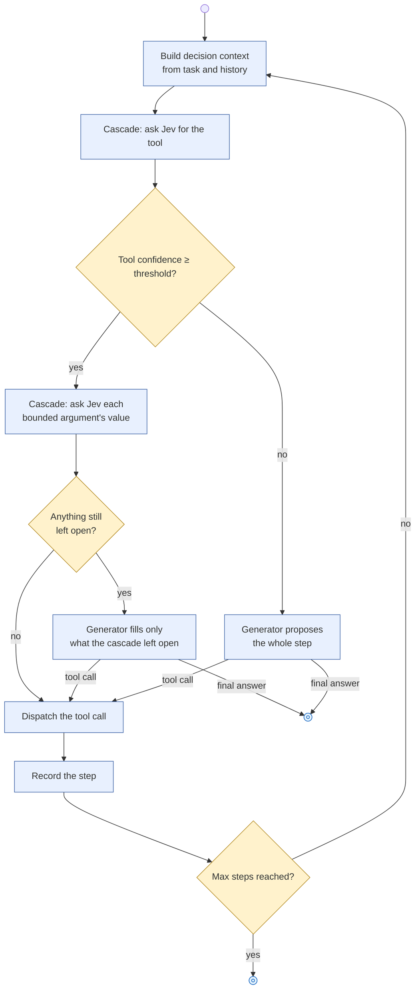
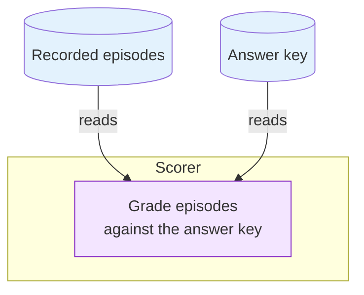

# DecisionBot

A live agent that solves [DABstep](https://huggingface.co/datasets/adyen/DABstep) data-analysis tasks by making tool calls against the real payments dataset, with the choice of which tool to call next, and the value of each of its bounded arguments, delegated to a decision model (Jev) whenever Jev is confident enough — the agent's own generation model (Sol) only decides what Jev defers. This reproduces the tool-and-argument cascade from "JevAgentHarness: Benchmarking, Deploying and Training Decision Models That Share Control with LLMs" (Zhu et al.), using the DABstep benchmark's tasks, data and documentation as the test environment, and Jev as the decision model.

DecisionBot's runs are scored against an independently computed answer key (`data/answer_key.jsonl`).

## Architecture

Two boundaries matter: the agent's own control plane, where a generation model and a decision model are both invoked but play different roles, and the Scorer, which is deliberately a separate system that never participates in solving a task — it only grades what the auv syncgent already recorded.

### Agent



The generation model (Sol) and the decision model (Jev) are invoked through the same kind of boundary but play different roles. At each step the cascade asks Jev which tool should be called next; if Jev's confidence on that choice clears the tool threshold, the choice is taken directly. For a chosen tool other than `finish`, the cascade separately asks Jev for the value of each bounded argument (one with a small, enumerable set of candidates drawn from the task and the step history), accepting each one whose confidence clears the argument threshold. Sol is only asked to decide what the cascade left open: the tool and arguments when Jev's tool confidence fell short, the remaining arguments when some were accepted and others were not, or the final answer text when the accepted choice is `finish`. The tools layer is three typed, fixed contracts: `query_transactions` and `compute_fees` cover filtering, aggregation and merchant-guide fee matching over the raw CSV/JSON files directly, and `query_data` runs one read-only SQL query over all of DABstep's tables for joins, percentiles and exact decimal arithmetic. Jev is never given a free-text channel — every judgment it returns is a probability over a small, enumerated set of options.

The tool and argument thresholds are not hand-set. They come from a calibration profile fitted by `src/calibrate.py` on shadow-mode runs: in shadow mode, the cascade still asks Jev for every tool and argument judgment and records its choice and confidence, but Sol always decides the actual step regardless of Jev's confidence. Whenever Jev's recorded choice disagrees with Sol's actual choice, DecisionBot forks the episode — it forces Jev's choice for that one decision and lets a baseline (Sol-only) continuation finish the task — and grades both the real episode and the forced continuation against the answer key, giving each decision a measured correctness label for Jev and for Sol. Paired with the measured dollar cost of the generator call that decision would have needed and an explicit, business-supplied dollar value for a correct task, `calibrate.py` sorts these labeled decisions into confidence bins and fits the lowest confidence above which every higher bin still shows a non-negative expected advantage to trusting Jev — the same rule the paper's cascade uses to set its thresholds.



Every step is recorded regardless of which side decided it, along with which Jev judgments were accepted and which were deferred, so the full episode — what Jev decided, what the generator filled in, and what finally got submitted — is reconstructible from `EpisodeResult` alone. `EpisodeResult` also carries the count of generator and Jev calls the episode actually made, so cascade runs can be compared against baseline (generator-only) runs on cost as well as success.

### Scoring



The Scorer is a separate system from the agent: it never runs a task, it only reads the episodes the agent already recorded and the answer key, and grades one against the other.

## Usage

Run from the project folder in a terminal:

1. `cd` into this repository.
2. Create `.env` in the repository root (not committed — `.gitignore` excludes it) with:
   ```
   TYPESAFE_API_KEY=your-jev-key
   OPENAI_API_KEY=your-openai-key
   ```
3. `uv sync` — creates `.venv` and installs the project.
4. Run `src/main.py` with `--mode` set to one of:
   - `baseline` — the generator decides every step by itself; only `OPENAI_API_KEY` is required.
   - `shadow` — the cascade asks Jev for every tool and argument judgment and records its choice, but the generator still decides every step; requires `--task-value-usd`, the dollar value assigned to one correct task, which drives the correctness labels this mode produces for calibration.
   - `cascade` (default) — Jev's accepted judgments bypass the generator; requires either `--calibration <profile.json>` from a prior fit, or explicit `--tool-threshold`/`--argument-threshold` values.

   Each run creates its own timestamped folder under `out/` (or the path given with `--output-dir`), fetching the DABstep data on first use and writing `run.json`, `episodes.jsonl`, a per-task debug log under `debug/`, and `scores.json` once every task has run. `--task-ids` restricts a run to specific DABstep task IDs.
5. To fit a calibration profile from shadow-mode runs, point `src/calibrate.py` at their debug logs:
   ```
   uv run src/calibrate.py <shadow-run>/debug/task_*.jsonl --output <profile.json> \
     --generator-model gpt-6.1-sol --jev-model jev-latest
   ```
   The resulting profile can then be passed to a `cascade` run with `--calibration <profile.json>`.
6. To grade a previously recorded `episodes.jsonl` without making any model calls, run `src/main.py --score-only <path>`.

To run and debug any of this in VSCode instead: run `uv sync` once from the terminal first (VSCode doesn't do this for you), then open the Command Palette and run **Python: Select Interpreter**, choosing the `.venv` that `uv sync` just created. From there, open the Run and Debug panel and launch the **DecisionBot** configuration, or add the arguments above to its `args` list in `.vscode/launch.json` — breakpoints are available anywhere in the call chain.
