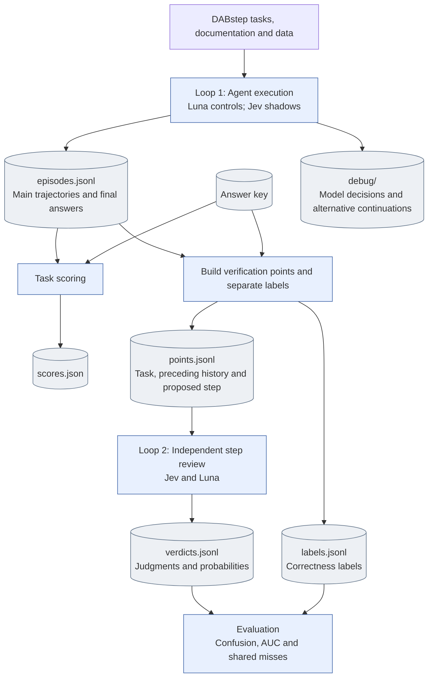
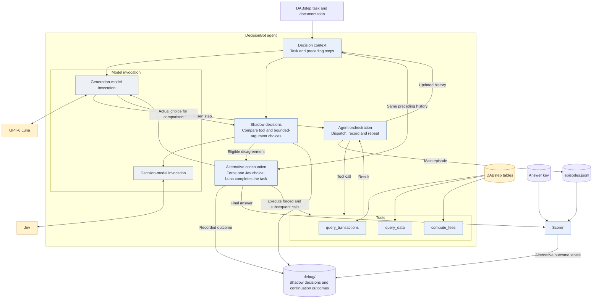
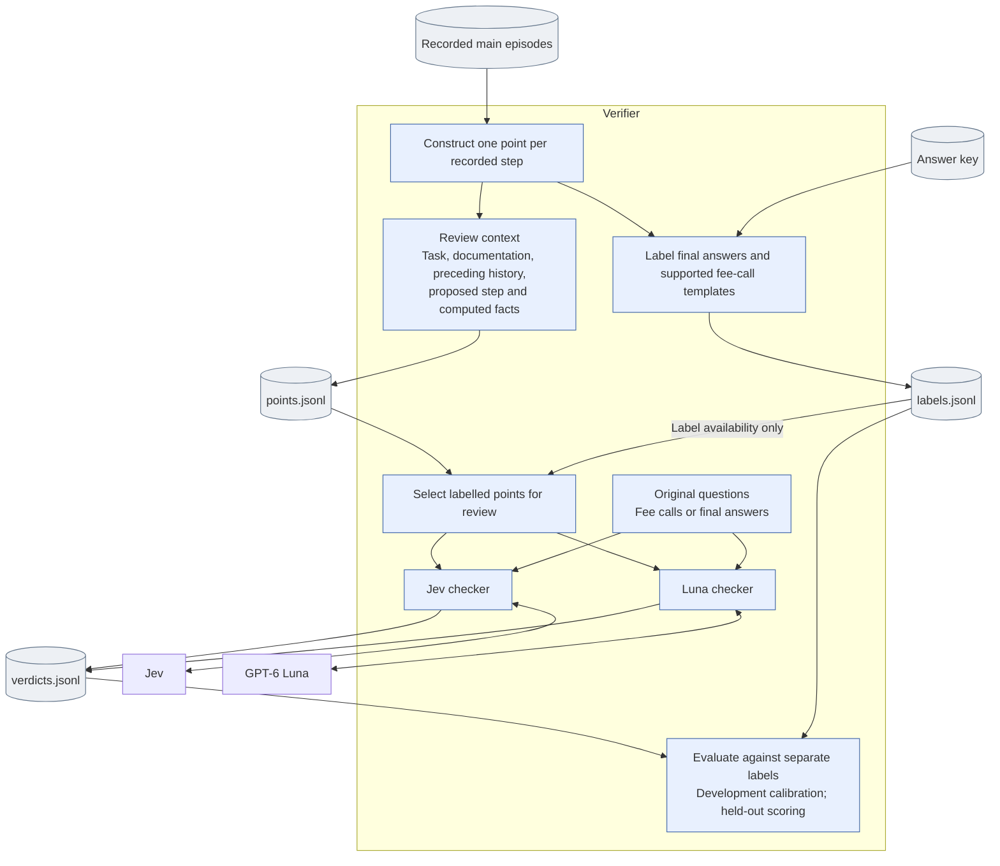

# DecisionBot

## Introduction

DecisionBot is an experimental harness for studying how an AI agent and independent verifiers succeed or fail on the same data-analysis tasks. It consists of two testing loops:

1. **Agent execution:** an autonomous agent uses model inference and tools to solve tasks from the [DABstep benchmark](https://huggingface.co/datasets/adyen/DABstep). In the **shadow configuration used for the published experiment**, Luna decides every step of the main trajectory while Jev proposes tool and bounded-argument choices alongside it. Eligible disagreements produce separate continuations that force one Jev choice before Luna resumes.
2. **Step verification:** recorded main episodes are replayed as review contexts. Jev and Luna independently assess each selected step using the task, documentation, and preceding trajectory. Their judgments are compared with separately constructed correctness labels to measure error detection, false alarms, and shared misses.

The second loop reviews recorded decisions; it does not intervene in the original agent run or execute its tools again. The published evaluation covered labelled `compute_fees` calls and final answers. SQL and `query_transactions` steps were recorded but excluded from that labelled evaluation.

### Experiment flow



The answer key and correctness labels are evaluation inputs. Neither the agent's decision context nor the verifier's review context includes them.

## Usage

### Setup

Run commands from the repository root.

1. Create `.env` with the model credentials:
   ```dotenv
   TYPESAFE_API_KEY=your-jev-key
   OPENAI_API_KEY=your-openai-key
   ```
2. Install the project into its virtual environment:
   ```sh
   uv sync
   ```

### Loop 1: Run the agent

```sh
uv run src/main.py --mode shadow --task-value-usd 1.0 --limit 5
```

This runs the first five tasks, fetching DABstep data on first use. Use `--limit 450` for the full benchmark, or `--task-ids` to select particular tasks. The `--task-value-usd` option supplies the task value required by shadow-mode decision records; it is not an API spending limit.

Each run creates a timestamped directory under `out/runs/` containing:

| Artifact | Contents |
|---|---|
| `run.json` | Run configuration |
| `episodes.jsonl` | Main episodes, including task, documentation, steps and final answer |
| `debug/` | Per-task model decisions, shadow comparisons and continuation logs |
| `scores.json` | Task-level scores against the answer key |

To score saved episodes without model calls:

```sh
uv run src/main.py --score-only out/runs/YOUR_RUN/episodes.jsonl
```

For VSCode debugging, select the repository's `.venv` interpreter and launch **DecisionBot**. Its current configuration runs shadow mode without a task limit; add `--limit` to its arguments for a smaller run.

### Loop 2: Run the verifiers

Set `AGENT_RUN` to the directory created by Loop 1 and choose a separate verification directory:

```sh
AGENT_RUN=out/runs/YOUR_RUN
R=out/verify/YOUR_VERIFIER_RUN

uv run src/verify.py build --episodes "$AGENT_RUN/episodes.jsonl" --run-dir "$R"

uv run src/verify.py ask --run-dir "$R" --checker decision --model jev-latest
uv run src/verify.py ask --run-dir "$R" --checker openai --model gpt-6-luna --effort medium

uv run src/verify.py report --run-dir "$R"
```

- `build` creates `points.jsonl` and `labels.jsonl` without model calls. It uses the recorded steps and introduces no seeded errors.
- `ask` reviews labelled steps by default and appends results to `verdicts.jsonl`. Repeating the same command resumes from cached successful responses. `--all` also reviews unlabelled steps; that expands beyond the published evaluation.
- `report` prints the built-in evaluation. Its per-question and composite-score selection is distinct from the paper's analysis, which used the action score `1 - P(proceed)` on pooled labelled steps.

The published experiment used `out/runs/shadow-20261022T041321930239Z/episodes.jsonl` and its original `verifier/` artifacts: 1,833 recorded steps, 909 labelled steps, and 430 labelled held-out steps. It used the original verification questions, without the `rule-questions` experiment.

## Architecture

### DecisionBot agent: shadow mode



Luna chooses the main trajectory's tool calls, arguments and final answer. Jev returns choices and probabilities over enumerated tool and argument options; its confidence does not override Luna in shadow mode.

For an eligible disagreement, the harness starts a separate continuation from the preceding history, forces one Jev choice, and lets Luna finish. A task can have several such continuations. They do not replace its main episode, and Loop 2 builds its verification points from the main episodes.

The tools provide three capabilities:

- `query_transactions`: filter, group and aggregate payments.
- `query_data`: execute read-only SQL over DABstep tables.
- `compute_fees`: match fee rules and calculate merchant fees.

### Verifier: recorded-step review



Each checker sees the proposed step as it appeared before taking effect, together with the available preceding context. It does not see later steps, the answer key, correctness labels or task scores.

For fee calls, the questions cover period, merchant, exclusions, hypothetical changes and the recommended action. For final answers, they cover the requested quantity, support from tool results, answerability, format and the recommended action. Both checkers return probabilities for the action choices **Proceed, Revise, Recheck and Ask**.

Correctness labels are constructed separately: final answers are graded against the answer key, while supported `compute_fees` templates are checked against the task's required arguments. Unlabelled steps do not enter the default correctness evaluation. Odd task IDs form the development set; even IDs form the held-out set.

### Scoring

The Scorer grades recorded answers; it does not participate in selecting the agent's next action. Main-agent task results and outcomes after individual forced Jev decisions are separate measurements.

Tasks with multiple interpretations are gradeable when every interpretation gives the same normalized answer. For the MCC and ACI fee-extreme templates, the scorer interprets "most expensive" as the highest single fee, using the empty-list-as-wildcard reading. This policy is selected from official DABstep grading evidence for task 1443 and applied across those template families; it is not established solely by the business manual or independently confirmed for every task. Score details record the selected interpretation and scoring basis. Tasks whose interpretations remain unresolved are reported as ambiguous and excluded from accuracy.
